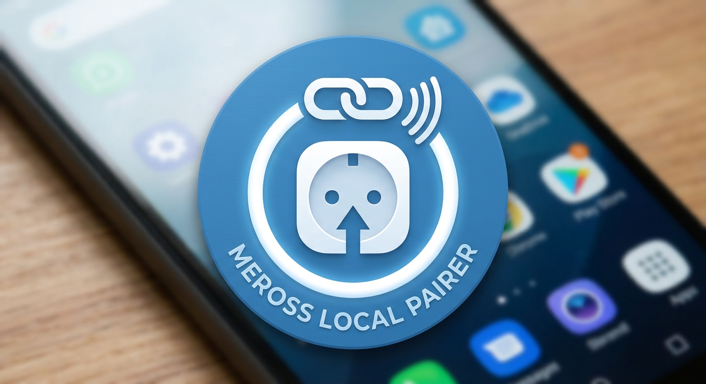

[English](README.md) · **Français**

# Meross Local Pairer — appairage Meross vers un broker local (non officiel)



Application Android qui configure un appareil Meross pour qu'il se connecte à
un broker MQTT local au lieu du cloud Meross. Elle est utilisée une seule fois,
lors de l'appairage ; ensuite Home Assistant pilote l'appareil localement.

**Version stable 2.1.1.** Elle gère l'appairage Wi-Fi classique et l'appairage
**Bluetooth LE** des appareils qui exposent une publicité `MRBL_…` — par
exemple les MRS100 récents, dont l'AP Wi-Fi n'est pas ouvert sans confirmation
BLE. Avec le broker **1.2.1 ou plus récent**, l'application se connecte exclusivement en
**HTTPS 2004**. Une recette F-Droid est préparée
(`fdroid/org.localpairer.yml`) ; l'application n'apparaîtra dans F-Droid
qu'après acceptation de la merge request dans `fdroiddata`.

Le MRS100 sert de référence de test ; l'application doit rester compatible
avec les autres appareils Meross pris en charge par le pairer local et les
familles du catalogue broker. **Toutes les familles ont besoin de testeurs sur
matériel réel** : ouvrez une issue en précisant le modèle, le firmware et les
fonctions qui marchent ou non. Les demandes d'intégration spécifiques sont
bienvenues.

## Les trois briques du montage

| Brique | Rôle | Dépôt |
|---|---|---|
| **Meross Local Pairer** | cette application Android | [mazkagaz/meross-local-pairer](https://github.com/mazkagaz/meross-local-pairer) |
| **Meross Local Broker** | add-on Home Assistant (MQTT/TLS + API HTTP/HTTPS) | [mazkagaz/meross-local-broker](https://github.com/mazkagaz/meross-local-broker) |
| **Meross Local Cloud** | intégration Home Assistant (HACS) | [mazkagaz/meross-local-cloud](https://github.com/mazkagaz/meross-local-cloud) |

```
Appareil Meross ──MQTT/TLS──> add-on Meross Local Broker ──API/MQTT──> intégration HA
                            ^
                            │ appairage initial
                 Meross Local Pairer (Android)
```

## Compatibilité des versions

| Brique | Version minimale | Remarques |
|---|---|---|
| Meross Local Pairer | 2.1.1 | HTTPS 2004 uniquement |
| Meross Local Broker | 1.2.1 | minimum ; 1.4.8 recommandé pour le profil MRS100 `2026.11.4` |
| Meross Local Cloud | 3.0.0-beta.3 | minimum ; 3.2.2 recommandée |

## Télécharger l'application

1. Ouvrir la page
   [Releases](https://github.com/mazkagaz/meross-local-pairer/releases/latest).
2. Télécharger le fichier `Meross-Local-Pairer-<version>.apk` de la dernière
   release (APK signé).
3. Sur Android 7.0 ou plus récent, autoriser l'installation depuis cette source
   si demandé.
4. Installer l'APK.

L'application n'est pas publiée sur le Play Store. La CI est configurée pour
signer les APK de release avec une clé stable du projet : les mises à jour
s'installeront ensuite par-dessus la version précédente. Une désinstallation
unique est nécessaire au passage d'une ancienne build signée avec une autre
clé (et plus tard au passage à F-Droid, qui utilise sa propre clé). Voir
`fdroid/README.md` pour la soumission F-Droid.

## Mises à jour

Les builds GitHub affichent un lien **Check for updates** dans **About** et
vérifient discrètement à l'ouverture si une release plus récente existe. Le
lien ouvre la page GitHub des releases ; un échec réseau est ignoré.

Les builds **F-Droid** désactivent le lien et la vérification. C'est déterminé
à la compilation avec `-PfdroidBuild=true`, et aussi à l'exécution lorsque
l'application a été installée par F-Droid.

## Avant l'appairage

- L'add-on **Meross Local Broker** est installé et démarré.
- Un **compte local** existe dans l'add-on (identifiant et mot de passe).
- Le téléphone et l'appareil Meross sont à portée Wi-Fi (et Bluetooth si
  l'appairage BLE est nécessaire).
- Le Wi-Fi domestique est en **2,4 GHz WPA2** : beaucoup d'appareils Meross ne
  gèrent ni le 5 GHz ni WPA3, vérifier la notice du modèle.
- L'appareil est en mode appairage : maintenir le bouton jusqu'au clignotement,
  selon la notice du modèle. Certains appareils récents, dont le MRS100, se
  mettent alors en **publicité Bluetooth** (`MRBL_…`) au lieu d'ouvrir un AP
  Wi-Fi.

## Réseaux Wi-Fi autorisés

Le broker et l'API locale sont contactés en HTTP(S) et MQTT/TLS :
l'application refuse donc de leur parler sur un réseau non validé. Au
démarrage, elle détecte le Wi-Fi courant et propose de le déclarer **réseau de
confiance**. S'il est accepté, il est ajouté automatiquement ; s'il est refusé,
l'application ne le redemande plus.

La gestion complète (réseaux validés, réseaux visibles, suppression) se trouve
dans **Settings → Advanced settings**. Les AP d'appairage `Meross_*` restent
implicitement autorisés pendant l'appairage. Le Wi-Fi choisi pour les appareils
IoT est **ajouté automatiquement** aux réseaux de confiance, même s'il diffère
de celui du téléphone. Android exige les permissions Wi-Fi/Localisation et les
services de localisation pour lire les noms de réseaux ; l'application les
demande au premier démarrage. Sur Android 17, elle demande aussi l'accès au
**réseau local**, requis pour mDNS, le broker et l'appairage.

## HTTPS et certificat du broker

L'écran de connexion ne demande que l'adresse de Home Assistant (nom ou IP) et
un interrupteur **HTTPS**. Avec le broker **1.2.1 ou plus récent**, laissez HTTPS activé :
l'API LAN n'est servie que sur **2004** en TLS. Le port **2003** est réservé à
l'ingress du Supervisor et n'est pas joignable depuis le téléphone. Le HTTP en
clair ne concerne que d'anciens brokers ; Android le bloque de toute façon vers
une adresse IP.

L'URL complète n'est jamais demandée : une URL collée par erreur est nettoyée
(schéma, chemin et port retirés). Pour un port personnalisé, activer
**Advanced settings** et renseigner le champ *HTTPS API port*.

La découverte mDNS est **automatique** à l'ouverture de l'écran de connexion :
l'application interroge le service `_meross-api._tcp` publié par l'add-on.
Le broker n'annonce que l'API **HTTPS** et les adresses LAN de Home
Assistant ; l'application teste leur joignabilité et préremplit l'hôte et le
port lorsque le champ est vide. Aucune adresse n'est préremplie si aucune ne
répond, et la saisie manuelle reste disponible pendant la recherche.

Le certificat du broker est auto-signé. L'application l'**épingle** au premier
contact : l'empreinte SHA-256 de la feuille est mémorisée pour ce
`hôte:port`, puis vérifiée à chaque connexion. Aucun certificat racine n'est
donc à installer sur le téléphone.

L'empreinte est visible dans **Settings → Advanced settings → Pairing
diagnostics**. Pour la comparer avec le broker :

```bash
openssl x509 -in /data/mqtt/certs/server.crt -noout -fingerprint -sha256
```

sur le certificat serveur (`server.crt` dans `/data/mqtt/certs` de l'add-on).
La CA se récupère séparément sur `/ca.crt`. Si le certificat du broker est
régénéré, la connexion échoue avec un message explicite : utiliser **Reset
pinned broker certificate** dans les diagnostics, puis se reconnecter.

## Mode Advanced settings

Un interrupteur **Advanced settings** dans Settings révèle les réglages
techniques, masqués par défaut :

- port API **HTTPS** (2004), modifiable ; le champ HTTP (2003) ne sert
  qu'aux brokers antérieurs à 1.0.0 ;
- endpoint complet calculé ;
- **User ID**, **HTTP Token** et **MQTT Key** ;
- **Manual API Setup** (bouton **Manual User/Key setup**, sans identifiants
  enregistrés) ;
- gestion des réseaux Wi-Fi de confiance ;
- diagnostics d'appairage et réinitialisation du certificat épinglé ;
- **Log in again**, utile après un changement de broker.

Le mode est mémorisé. Le désactiver ne supprime aucun réglage.

## Appairage pas à pas

1. Ouvrir Meross Local Pairer et accorder les permissions Wi-Fi et localisation.
2. Se connecter au broker local :
   - saisir l'adresse de Home Assistant : `homeassistant.local` ou son IP ;
   - laisser **HTTPS** activé (obligatoire avec le broker 1.2.1) ;
   - saisir l'identifiant local et le mot de passe local.

   L'application construit seule `https://<adresse>:2004`. Pour un port
   personnalisé, activer **Advanced settings** dans Settings. Le bouton
   **Manual User/Key setup** ouvre la page
   **Manual API Setup** (User ID + MQTT Key, souvent `1` et la clé du compte
   local), uniquement visible en mode avancé et sans credentials enregistrés.
3. Revenir à l'écran d'appairage, puis choisir la méthode selon l'appareil :

   **Sans Bluetooth LE — AP Wi-Fi**
   1. Scanner et sélectionner l'AP `Meross_*` de l'appareil (par exemple
      `Meross_RS_*` pour un volet).
   2. Sélectionner le Wi-Fi domestique et saisir son mot de passe.
   3. Saisir le broker : hôte = IP de Home Assistant (ou
      `homeassistant.local`), port = **2001**, et le **Device name** (nom
      unique et obligatoire). Le port doit accepter **MQTT over TLS** ; une
      configuration personnalisée est vérifiée avant l'appairage et un message
      explicite s'affiche si ce n'est pas le cas.
   4. Lancer l'appairage. L'appareil redémarre, rejoint le Wi-Fi et se connecte
      au broker.

   **Avec Bluetooth LE — `MRBL_…`**
   1. La détection Bluetooth est automatique : les appareils `MRBL_…`
      apparaissent sous **Meross Bluetooth devices**, à côté des AP Wi-Fi.
   2. Toucher l'appareil `MRBL_…`. L'application se connecte seule et lit son
      identité (UUID/MAC/type) ainsi que sa liste Wi-Fi.
   3. Le Wi-Fi courant ou déjà mémorisé est présélectionné ; le mot de passe
      est rempli automatiquement s'il a été enregistré lors d'un appairage
      précédent (case **Remember this Wi-Fi password**). Saisir le
      **Device name** (nom unique et obligatoire), puis **Configure device**.
      Le broker local déjà configuré dans l'application est utilisé
      (port 2001).
   4. L'application vérifie que l'appareil devient **ONLINE** ; elle n'affiche
      pas de succès si ce n'est pas le cas.

4. Vérifier dans l'add-on que l'appareil est **ONLINE**, puis ajouter
   l'[intégration Home Assistant](https://github.com/mazkagaz/meross-local-cloud/blob/main/README.fr.md#installation-avec-hacs).

Après l'appairage, les entités `cover`, `number` (Position et durées), les
boutons de calibration et le capteur de statut sont créés dans Home Assistant.

## Gérer les appareils

**Toucher une ligne** ouvre le renommage de l'appareil : le nouveau nom est
enregistré dans le broker (`POST /v1/Device/name`) et doit être unique, sans
tenir compte de la casse.

L'icône corbeille permet de **supprimer un appareil** du broker après
confirmation. L'opération utilise l'API authentifiée du broker
(`POST /v1/Device/delete`) ; elle échoue avec un message si l'API n'est pas
joignable.

La suppression **révoque** aussi le MAC : l'appareil ne peut plus se reconnecter
seul avec les identifiants qu'il conserve. Un nouvel appairage réussit appelle
automatiquement `POST /v1/Device/claim` pour lever la révocation. L'appareil
garde le même UUID, donc les entités et automatisations Home Assistant
existantes restent valides après oubli puis réappairage.

Le broker publie `Appliance.Control.Unbind` vers l'intégration : les entités
disparaissent immédiatement. Avec Meross Local Cloud **3.0.0-beta.3**, un
appareil qui ne revient pas est proposé à la suppression après 48 heures.

## Dépannage

| Problème | Vérifier |
|---|---|
| L'AP `Meross_*` n'apparaît pas | mode appairage activé ; si l'appareil expose `MRBL_…`, utiliser l'appairage Bluetooth |
| Aucun appareil `MRBL_…` en Bluetooth | Bluetooth activé, permissions Bluetooth/localisation, appareil en mode appairage, à portée |
| Connexion impossible | vérifier `homeassistant.local`/IP et le toggle HTTPS ; en dernier recours, **Manual API Setup** dans Advanced settings |
| Certificat TLS modifié | **Reset pinned broker certificate** dans Settings, puis se reconnecter |
| « Trust this Wi-Fi network? » refusé | accepter au démarrage, ou ajouter le réseau dans **Advanced settings** |
| « Untrusted Wi-Fi network » | accepter le réseau courant, ou le gérer dans **Advanced settings** |
| Suppression d'appareil refusée | broker 1.2.1, API HTTPS 2004 accessible, appareil du compte courant |
| Entités encore visibles après suppression | intégration 3.0.0-beta.3+, Unbind immédiat ; réparation 48 h ou suppression manuelle |
| Échec des identifiants | compte local de l'add-on, `UserId`/`mqttKey` corrects |
| L'appareil ne rejoint pas le Wi-Fi | WPA2 2,4 GHz, mot de passe, portée |
| L'appareil n'est pas ONLINE | port 2001 joignable, broker démarré, logs de l'add-on |
| Appareil déjà lié au cloud Meross | réinitialiser l'appareil avant l'appairage |
| WPA3 uniquement | utiliser un SSID WPA2 ou un réseau 2,4 GHz dédié |

## Pour les développeurs

```bash
./gradlew test
./gradlew assembleDebug
./gradlew assembleReleaseUnsigned
```

Le build nécessite JDK 17 et Android SDK 37. Les tests couvrent le format
`Appliance.Config.Key` et la validation des réponses AP (SETACK/ERROR) ;
l'appairage BLE se teste sur un appareil réel.

La CI signe les APK avec une clé stable fournie par les secrets GitHub
(`ANDROID_KEYSTORE_BASE64`, `ANDROID_KEYSTORE_PASSWORD`,
`ANDROID_KEY_ALIAS`, `ANDROID_KEY_PASSWORD`). Ne jamais committer le keystore
ni ses mots de passe.

Traductions de la documentation :
[politique](docs/TRANSLATIONS.md) et
[glossaire](docs/TRANSLATION-GLOSSARY.md).

## Origine et licence

Fork non officiel de
[Custom Pairer for Meross Devices](https://github.com/albertogeniola/Custom-Meross-Pairer)
par Alberto Geniola, sous **GPL-2.0**. Le README upstream est conservé dans
`UPSTREAM_README.md` ; voir aussi `NOTICE` et `MODIFICATIONS.md`.

Ce fork n'est ni affilié, ni approuvé, ni sponsorisé par Meross ou l'auteur
upstream. Meross est une marque de son propriétaire respectif.
