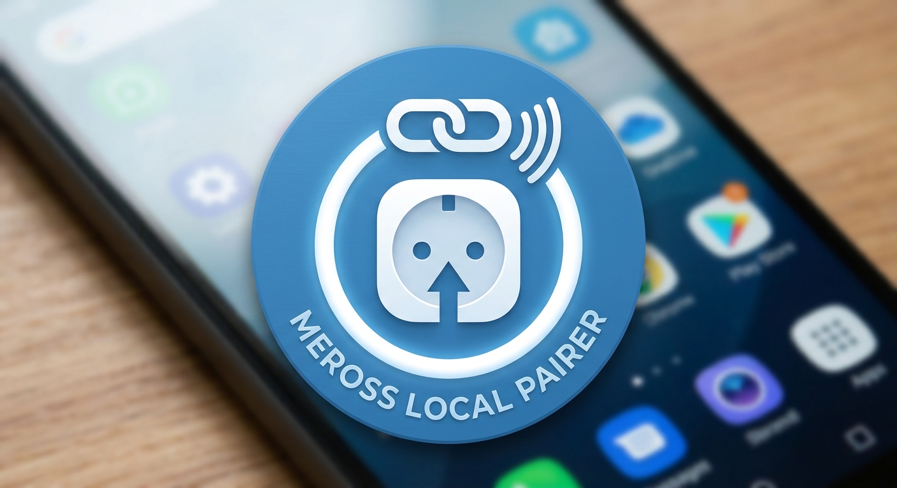

**English** · [Français](README.fr.md)

# Meross Local Pairer — pair Meross devices with a local broker (unofficial)



Android app that configures a Meross device to connect to a local MQTT broker
instead of the Meross cloud. It is used once, during pairing; afterwards Home
Assistant controls the device locally.

**Stable version 2.1.1.** It supports classic Wi-Fi pairing and **Bluetooth LE**
pairing for devices advertising `MRBL_…` — for example recent MRS100 units,
whose Wi-Fi AP does not open without BLE confirmation. With broker **1.2.1 or
newer**, the app connects over **HTTPS 2004** only. An F-Droid recipe is
prepared (`fdroid/org.localpairer.yml`); the app will only appear in F-Droid
after the merge request in `fdroiddata` is accepted.

The MRS100 is the test reference; the app must remain compatible with the other
Meross devices supported by the local pairer and by the broker catalog
families. **All families need testers on real hardware**: open an issue with
the model, firmware and the functions that work or fail. Requests for specific
device families are welcome.

## The three building blocks

| Component | Role | Repository |
| --- | --- | --- |
| **Meross Local Pairer** | this Android app | [mazkagaz/meross-local-pairer](https://github.com/mazkagaz/meross-local-pairer) |
| **Meross Local Broker** | Home Assistant add-on (MQTT/TLS + HTTP/HTTPS API) | [mazkagaz/meross-local-broker](https://github.com/mazkagaz/meross-local-broker) |
| **Meross Local Cloud** | Home Assistant integration (HACS) | [mazkagaz/meross-local-cloud](https://github.com/mazkagaz/meross-local-cloud) |

```
Meross device ──MQTT/TLS──> Meross Local Broker add-on ──API/MQTT──> HA integration
                            ^
                            │ initial pairing
                 Meross Local Pairer (Android)
```

## Version compatibility

| Component | Minimum version | Notes |
| --- | --- | --- |
| Meross Local Pairer | 2.1.1 | HTTPS 2004 only |
| Meross Local Broker | 1.2.1 | minimum; 1.4.8 recommended for the MRS100 `2026.11.4` profile |
| Meross Local Cloud | 3.0.0-beta.3 | minimum; 3.2.2 recommended |

## Downloading the app

1. Open the
   [Releases](https://github.com/mazkagaz/meross-local-pairer/releases/latest)
   page.
2. Download the `Meross-Local-Pairer-<version>.apk` file from the latest release
   (signed APK).
3. On Android 6.0 or newer, allow installation from this source if prompted.
4. Install the APK.

The app is not published on the Play Store. CI is configured to sign release
APKs with a stable project key: updates then install over the previous version.
A one-time uninstall is required when moving from an older build signed with a
different key (and later when moving to F-Droid, which uses its own key). See
`fdroid/README.md` for the F-Droid submission.

## Updates

GitHub builds show a **Check for updates** link in **About** and quietly check
at startup whether a newer release exists. The link opens the GitHub releases
page; network failures are ignored.

**F-Droid** builds disable the link and the check. This is decided at build time
with `-PfdroidBuild=true`, and also at runtime when the app was installed by
F-Droid.

## Before pairing

- The **Meross Local Broker** add-on is installed and running.
- A **local account** exists in the add-on (login and password).
- The phone and the Meross device are within Wi-Fi range (and Bluetooth if BLE
  pairing is needed).
- The home Wi-Fi is **2.4 GHz WPA2**: many Meross devices support neither 5 GHz
  nor WPA3; check the model documentation.
- The device is in pairing mode: hold the button until it blinks, according to
  the model documentation. Some recent devices, including the MRS100, then
  enter **Bluetooth advertising** (`MRBL_…`) instead of opening a Wi-Fi AP.

## Trusted Wi-Fi networks

The broker and local API are contacted over HTTP(S) and MQTT/TLS: the app
therefore refuses to talk to them on an unvalidated network. At startup it
detects the current Wi-Fi network and offers to mark it as a **trusted
network**. If accepted, it is added automatically; if declined, the app does
not ask again.

Full management (trusted networks, visible networks, removal) is in
**Settings → Advanced settings**. Pairing APs (`Meross_*`) remain implicitly
allowed during pairing. The Wi-Fi chosen for IoT devices is **added
automatically** to the trusted networks, even if it differs from the phone's
network. Android requires Wi-Fi/Location permissions and location services to
read network names; the app requests them on first start. On Android 17 it
also requests **local network** access, required for mDNS, the broker and
pairing.

## HTTPS and broker certificate

The login screen only asks for the Home Assistant address (name or IP) and an
**HTTPS** switch. With broker **1.2.1 or newer**, leave HTTPS enabled: the LAN
API is only served on **2004** with TLS. Port **2003** is reserved for the
Supervisor ingress and is not reachable from the phone. Cleartext HTTP only
concerns old brokers; Android blocks it for IP addresses anyway.

The full URL is never requested: a pasted URL is cleaned (scheme, path and port
removed). For a custom port, enable **Advanced settings** and fill in the
*HTTPS API port* field.

mDNS discovery is **automatic** when the login screen opens: the app queries
the `_meross-api._tcp` service published by the add-on. The broker advertises
only the **HTTPS** API and Home Assistant's LAN addresses; the app tests their
reachability and pre-fills the host and port when the field is empty. No
address is pre-filled if none responds, and manual entry remains available
during discovery.

The broker certificate is self-signed. The app **pins** it on first contact: the
SHA-256 fingerprint of the leaf certificate is stored for that `host:port`, then
verified on every connection. No root certificate needs to be installed on the
phone.

The fingerprint is visible in **Settings → Advanced settings → Pairing
diagnostics**. To compare it with the broker:

```bash
openssl x509 -in /data/mqtt/certs/server.crt -noout -fingerprint -sha256
```

on the server certificate (`server.crt` in the add-on's `/data/mqtt/certs`). The
CA is fetched separately from `/ca.crt`. If the broker certificate is
regenerated, the connection fails with an explicit message: use **Reset pinned
broker certificate** in diagnostics, then reconnect.

## Advanced settings mode

An **Advanced settings** switch in Settings reveals the technical settings,
hidden by default:

- **HTTPS** API port (2004), editable; the HTTP field (2003) only serves
  brokers older than 1.0.0;
- computed full endpoint;
- **User ID**, **HTTP Token** and **MQTT Key**;
- **Manual API Setup** (**Manual User/Key setup** button, without stored
  credentials);
- trusted Wi-Fi network management;
- pairing diagnostics and pinned certificate reset;
- **Log in again**, useful after changing broker.

The mode is remembered. Disabling it does not remove any setting.

## Pairing step by step

1. Open Meross Local Pairer and grant the Wi-Fi and location permissions.
2. Connect to the local broker:
   - enter the Home Assistant address: `homeassistant.local` or its IP;
   - leave **HTTPS** enabled (required with broker 1.2.1);
   - enter the local login and local password.

   The app builds `https://<address>:2004` itself. For a custom port, enable
   **Advanced settings** in Settings. The **Manual User/Key setup** button opens
   the **Manual API Setup** page (User ID + MQTT Key, often `1` and the local
   account key), visible only in advanced mode and without stored credentials.
3. Return to the pairing screen, then choose the method for the device:

   **Without Bluetooth LE — Wi-Fi AP**
   1. Scan and select the device's `Meross_*` AP (for example `Meross_RS_*` for
      a shutter).
   2. Select the home Wi-Fi and enter its password.
   3. Enter the broker: host = Home Assistant IP (or `homeassistant.local`),
      port = **2001**, and the **Device name** (unique and required). The port
      must accept **MQTT over TLS**; a custom configuration is verified before
      pairing and an explicit message is shown if it is not the case.
   4. Start pairing. The device restarts, joins the Wi-Fi and connects to the
      broker.

   **With Bluetooth LE — `MRBL_…`**
   1. Bluetooth detection is automatic: `MRBL_…` devices appear under **Meross
      Bluetooth devices**, next to Wi-Fi APs.
   2. Tap the `MRBL_…` device. The app connects by itself and reads its identity
      (UUID/MAC/type) and Wi-Fi list.
   3. The current or previously stored Wi-Fi is pre-selected; the password is
      filled automatically if it was saved during a previous pairing (**Remember
      this Wi-Fi password** checkbox). Enter the **Device name** (unique and
      required), then **Configure device**. The broker already configured in the
      app is used (port 2001).
   4. The app verifies that the device becomes **ONLINE**; it does not report
      success otherwise.

4. Check in the add-on that the device is **ONLINE**, then add the
   [Home Assistant integration](https://github.com/mazkagaz/meross-local-cloud#install-with-hacs).

After pairing, the `cover`, `number` (Position and durations), calibration
button and status sensor entities are created in Home Assistant.

## Managing devices

**Tapping a row** opens device renaming: the new name is stored in the broker
(`POST /v1/Device/name`) and must be unique, case-insensitively.

The trash icon **removes a device** from the broker after confirmation. The
operation uses the broker's authenticated API (`POST /v1/Device/delete`); it
fails with a message if the API is unreachable.

Removal also **revokes** the MAC: the device can no longer reconnect on its own
with the credentials it keeps. A successful new pairing automatically calls
`POST /v1/Device/claim` to lift the revocation. The device keeps the same UUID,
so existing Home Assistant entities and automations remain valid after
forget/re-pair.

The broker publishes `Appliance.Control.Unbind` to the integration: entities
disappear immediately. With Meross Local Cloud **3.0.0-beta.3**, a device that
does not come back is proposed for removal after 48 hours.

## Troubleshooting

| Problem | Check |
| --- | --- |
| The `Meross_*` AP does not appear | pairing mode enabled; if the device advertises `MRBL_…`, use Bluetooth pairing |
| No `MRBL_…` device over Bluetooth | Bluetooth enabled, Bluetooth/location permissions, device in pairing mode, in range |
| Cannot connect | check `homeassistant.local`/IP and the HTTPS toggle; as a last resort, **Manual API Setup** in Advanced settings |
| TLS certificate changed | **Reset pinned broker certificate** in Settings, then reconnect |
| “Trust this Wi-Fi network?” declined | accept at startup, or add the network in **Advanced settings** |
| “Untrusted Wi-Fi network” | accept the current network, or manage it in **Advanced settings** |
| Device removal refused | broker 1.2.1, HTTPS API 2004 reachable, device owned by the current account |
| Entities still visible after removal | integration 3.0.0-beta.3+, immediate Unbind; 48 h repair or manual deletion |
| Credentials fail | add-on local account, correct `UserId`/`mqttKey` |
| The device does not join Wi-Fi | 2.4 GHz WPA2, password, range |
| The device is not ONLINE | port 2001 reachable, broker running, add-on logs |
| Device already linked to the Meross cloud | reset the device before pairing |
| WPA3 only | use a WPA2 SSID or a dedicated 2.4 GHz network |

## For developers

```bash
./gradlew test
./gradlew assembleDebug
./gradlew assembleReleaseUnsigned
```

The build requires JDK 17 and Android SDK 37. Tests cover the
`Appliance.Config.Key` format and AP response validation (SETACK/ERROR); BLE
pairing is tested on a real device.

CI signs APKs with a stable key provided by GitHub secrets
(`ANDROID_KEYSTORE_BASE64`, `ANDROID_KEYSTORE_PASSWORD`, `ANDROID_KEY_ALIAS`,
`ANDROID_KEY_PASSWORD`). Never commit the keystore or its passwords.

Documentation translations: [policy](docs/TRANSLATIONS.md) and
[glossary](docs/TRANSLATION-GLOSSARY.md).

## Origin and license

Unofficial fork of
[Custom Pairer for Meross Devices](https://github.com/albertogeniola/Custom-Meross-Pairer)
by Alberto Geniola, under **GPL-2.0**. The upstream README is kept in
`UPSTREAM_README.md`; see also `NOTICE` and `MODIFICATIONS.md`.

This fork is neither affiliated with, approved by, nor sponsored by Meross or
the upstream author. Meross is a trademark of its respective owner.
